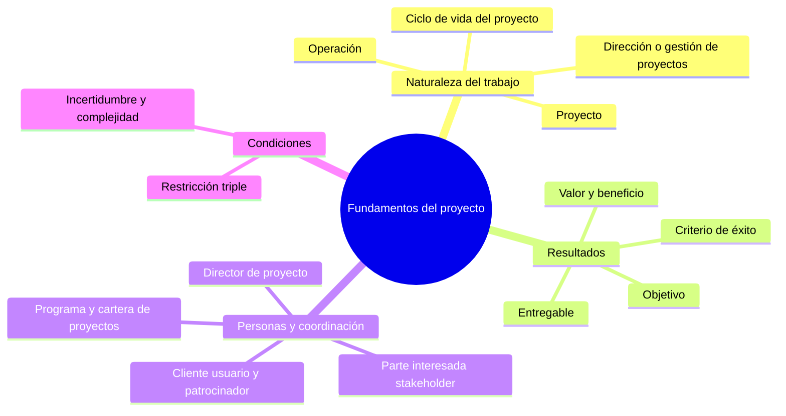
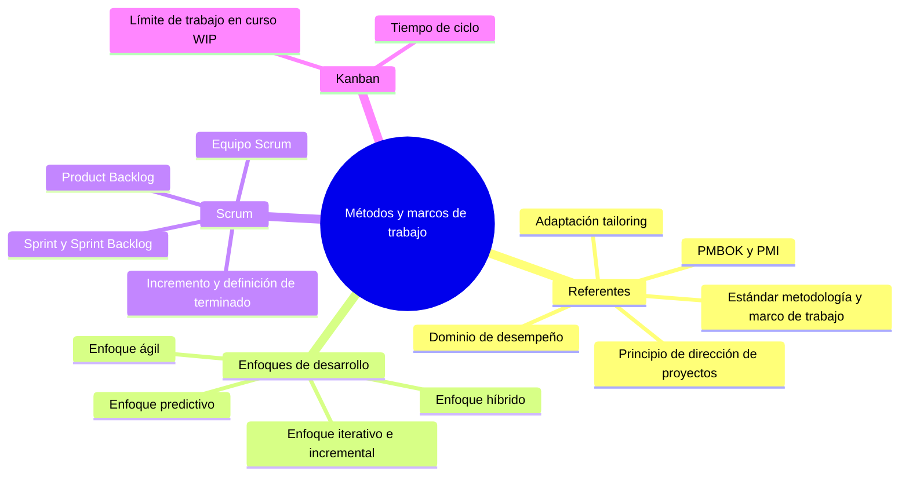
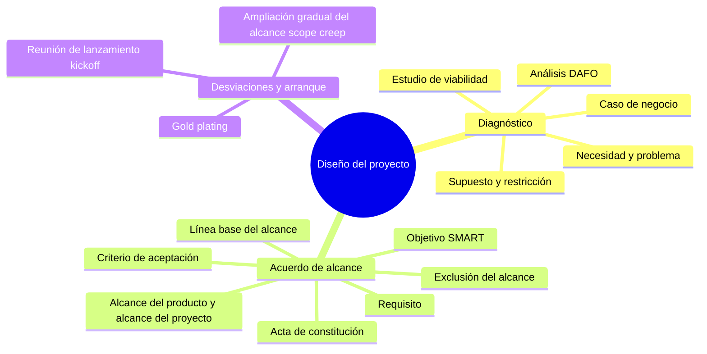
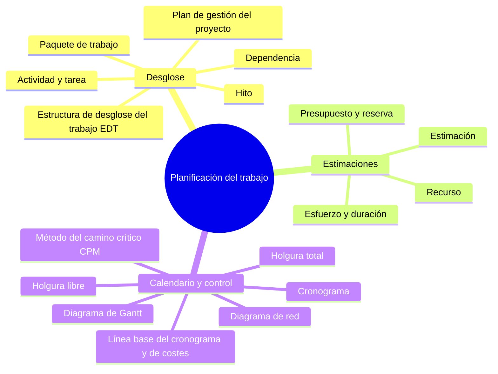
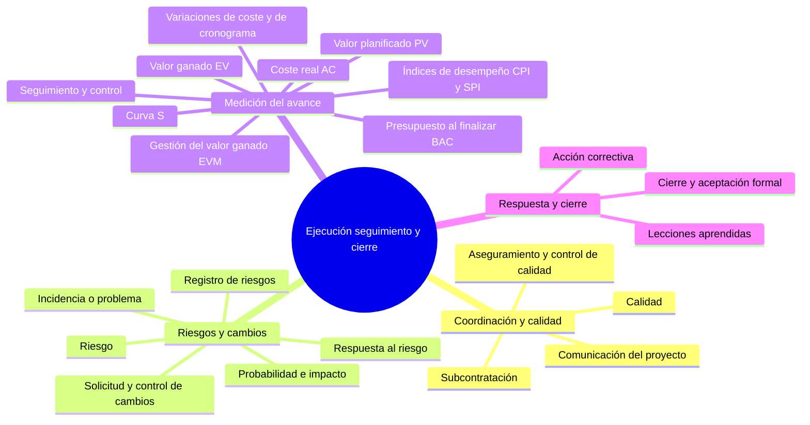
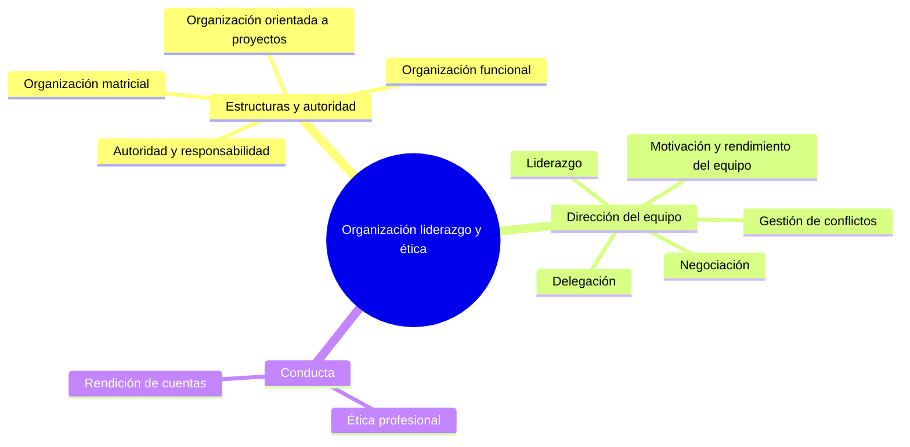
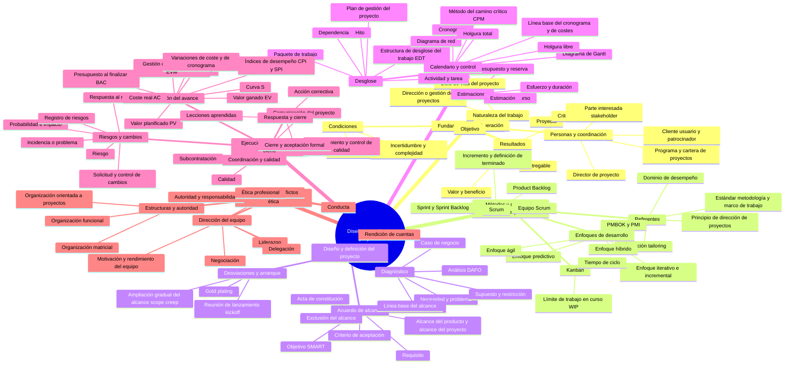

## Introducción

Un proyecto tecnológico convierte una necesidad en un resultado concreto dentro
de un plazo y con recursos limitados. Puedes pensar en el despliegue de una
plataforma de matrícula. Primero debes decidir qué problema resuelve y para
quién; después, definir entregables, organizar el trabajo, controlar el avance
y preparar la entrega a quienes operarán la plataforma.

Este glosario sigue ese recorrido. Reúne los conceptos necesarios para
distinguir un proyecto de la operación cotidiana, elegir un enfoque de trabajo,
diseñar y planificar la solución, gestionar su ejecución y dirigir al equipo.
Las definiciones incluyen ejemplos breves y conectan los documentos, las
técnicas y las decisiones que suelen confundirse entre sí.

---

## Tabla de contenido

---

## 1. Fundamentos del proyecto

Antes de elegir un método, delimita el trabajo temporal y el resultado que
esperas obtener. Esa distinción permite fijar objetivos y reconocer a las
personas que pueden influir en ellos.

### Proyecto

Esfuerzo temporal para crear un producto, servicio o resultado singular. Crear
una plataforma de matrícula es un proyecto; atender cada año las inscripciones
con la plataforma terminada es una operación. «Temporal» describe el esfuerzo,
no la vida útil de su resultado.

### Operación

Trabajo recurrente que mantiene funcionando un servicio o proceso. Tiene
procedimientos y resultados relativamente estables, aunque también puede
mejorarse mediante proyectos. El equipo de soporte opera la plataforma después
de que termina su implantación.

### Dirección o gestión de proyectos

Aplicación coordinada de conocimientos, personas, herramientas y decisiones
para cumplir los objetivos acordados. Incluye preparar el trabajo, ejecutarlo,
comparar resultados con el plan y corregir desviaciones. Gestionar no equivale
solo a confeccionar un cronograma.

### Ciclo de vida del proyecto

Secuencia de etapas desde la idea hasta el cierre. Puede incluir inicio,
diseño, planificación, ejecución y cierre; algunas etapas se repiten si el
producto se desarrolla por incrementos. El ciclo de vida describe cuándo se
toman decisiones, mientras que un método indica cómo se trabaja.

### Objetivo

Resultado que el proyecto busca alcanzar. Conviene formularlo de modo que
puedas comprobarlo: «permitir que 5 000 alumnos se inscriban en línea antes de
agosto» orienta mejor las decisiones que «modernizar la matrícula». El objetivo
guía el alcance y los criterios de aceptación.

### Criterio de éxito

Condición con la que se juzga si el proyecto logró lo que se esperaba. Puede
referirse a un plazo, un coste, una capacidad técnica o la adopción por los
usuarios. Conviene acordarla al inicio porque entregar software no demuestra,
por sí solo, que resolvió la necesidad.

### Entregable

Resultado verificable producido durante el proyecto o al terminarlo. Puede ser
una aplicación, un manual, una prueba de seguridad o una formación. Si divides
el resultado final en entregables, podrás estimar y aceptar el trabajo con más
precisión.

### Valor y beneficio

El **valor** es la utilidad que los resultados aportan a quienes los reciben;
el **beneficio** es una mejora observable que puede aparecer después de la
entrega. Una plataforma operativa es un entregable; reducir el tiempo de
inscripción es un beneficio. Esta diferencia evita confundir producir algo con
obtener su efecto esperado.

### Parte interesada (_stakeholder_)

Persona, grupo u organización que puede afectar al proyecto o resultar
afectada por él. En la plataforma de matrícula participan estudiantes,
administración, soporte y autoridades. Identifica sus intereses y su capacidad
de decisión antes de fijar requisitos.

### Cliente, usuario y patrocinador

El **cliente** solicita o recibe el resultado; el **usuario** lo utiliza en la
práctica; el **patrocinador** respalda el proyecto y facilita recursos o
decisiones. Pueden coincidir, pero no siempre. La universidad puede financiar
la plataforma mientras que estudiantes y personal administrativo la usan de
formas distintas.

### Director de proyecto

Persona responsable de coordinar al equipo y las decisiones necesarias para
alcanzar los objetivos. Gestiona expectativas, dependencias, recursos y
desviaciones, aunque la autoridad sobre cada especialista depende de la
estructura de la organización.

### Programa y cartera de proyectos

Un **programa** coordina proyectos relacionados para obtener beneficios que
sería difícil lograr por separado. Una **cartera** agrupa proyectos y programas
para decidir cuáles conviene financiar según la estrategia y los recursos
disponibles. Un proyecto entrega un resultado; programa y cartera responden a
decisiones de coordinación y prioridad más amplias.

### Restricción triple

Relación entre alcance, tiempo y coste que ayuda a analizar decisiones. Si
añades funciones sin ampliar plazo ni presupuesto, aumenta la presión sobre el
equipo y la calidad. La calidad, el riesgo y los recursos también importan;
por eso el triángulo sirve como recordatorio y no como modelo completo del
éxito.

### Incertidumbre y complejidad

La **incertidumbre** expresa lo que aún no sabes, como la demanda real del
servicio. La **complejidad** aparece cuando muchas partes interactúan y un
cambio tiene efectos difíciles de prever. Ambas influyen en cuánto debes
planificar por adelantado y cuánto conviene aprender durante la ejecución.

## 2. Métodos y marcos de trabajo

Una vez aclarado el propósito, elige una forma de organizar las decisiones y
las entregas. Ningún enfoque sustituye la definición del problema ni la
responsabilidad de comprobar los resultados.

### Estándar, metodología y marco de trabajo

Un **estándar** reúne principios o prácticas de referencia; una
**metodología** prescribe procedimientos que una organización adopta; un
**marco de trabajo** fija elementos y reglas con margen para concretar su
aplicación. Elige o adapta estos instrumentos según el contexto, sin tratar
una guía de conocimientos como una receta única.

### PMBOK y PMI

El **Project Management Institute** (PMI) publica estándares para la dirección
de proyectos. La **Guía del PMBOK** organiza conocimientos y prácticas de
referencia. Su séptima edición presenta doce principios y ocho dominios de
desempeño; no obliga a ejecutar todos los proyectos con una secuencia fija de
procesos.

### Principio de dirección de proyectos

Orientación que ayuda a decidir en situaciones distintas. En la séptima edición
del PMBOK, los principios abarcan, entre otros temas, crear valor, colaborar,
involucrar a los interesados, incorporar calidad y responder a riesgos. Se
aplican al decidir cómo trabajar, no como casillas de una lista de tareas.

### Dominio de desempeño

Conjunto de actividades relacionadas que contribuyen al resultado. La séptima
edición del PMBOK distingue interesados, equipo, enfoque de desarrollo y ciclo
de vida, planificación, trabajo, entrega, medición e incertidumbre. Los dominios
se influyen entre sí durante todo el proyecto.

### Adaptación (_tailoring_)

Selección y ajuste de prácticas para un proyecto concreto. Puedes exigir más
revisiones de seguridad en una plataforma que maneja datos personales y menos
formalidad documental en un prototipo interno. Adaptar exige justificar las
decisiones y conservar el control necesario.

### Enfoque predictivo

Forma de trabajo que define gran parte del alcance y la planificación antes de
ejecutar. Conviene cuando los requisitos son suficientemente estables y la
secuencia de entregas se conoce. Predecir no elimina cambios; requiere un
mecanismo para evaluarlos y actualizar el plan.

### Enfoque iterativo e incremental

En un trabajo **iterativo** se revisa una solución varias veces para mejorarla.
En uno **incremental** se entregan partes funcionales que amplían el producto.
Una plataforma puede empezar con el registro y agregar después la selección de
asignaturas, mientras se revisa cada parte con los usuarios.

### Enfoque ágil

Forma de organizar el trabajo que favorece la colaboración, la entrega
frecuente y la respuesta a la información nueva. Tiene sentido cuando el equipo
puede recibir retroalimentación útil y ajustar prioridades. No significa
trabajar sin objetivos, sin planificación o sin control de calidad.

### Enfoque híbrido

Combinación deliberada de prácticas predictivas y adaptativas. Por ejemplo,
puedes fijar por adelantado la fecha de cumplimiento normativo y desarrollar
la interfaz en incrementos. Documenta qué decisiones permanecen estables y
cuáles se revisarán al aprender.

### Scrum

Marco de trabajo para abordar problemas complejos mediante ciclos breves de
entrega e inspección. Define responsabilidades, eventos y artefactos. Su
aplicación exige un objetivo de producto y un equipo capaz de construir
incrementos utilizables, no solo reuniones con nombres nuevos.

### Equipo Scrum

Conjunto formado por **Product Owner**, **Scrum Master** y
**Developers**. El Product Owner ordena el trabajo para maximizar el valor;
el Scrum Master ayuda a que Scrum se comprenda y funcione; los Developers crean
el incremento. Estas responsabilidades no son una copia directa de la jerarquía
de una organización tradicional.

### _Product Backlog_

Lista ordenada y cambiante del trabajo necesario para mejorar el producto.
Contiene elementos que pueden aclararse y dividirse conforme se aprende. Su
orden ayuda al equipo a elegir qué aporta más valor, sujeto a las restricciones
del proyecto.

### _Sprint_ y _Sprint Backlog_

El **Sprint** es un periodo de hasta un mes en el que el equipo busca un
objetivo y produce un incremento utilizable. El **Sprint Backlog** reúne ese
objetivo, los elementos seleccionados del Product Backlog y el plan para
realizarlos. Al terminar, se inspecciona el resultado y se ajusta el trabajo
siguiente.

### Incremento y definición de terminado

El **incremento** reúne trabajo completado que puede utilizarse. La
**definición de terminado** establece las condiciones de calidad que debe
cumplir, por ejemplo pruebas, revisión y documentación operativa. Sin ese
acuerdo, dos personas pueden declarar «acabada» la misma función con criterios
incompatibles.

### Kanban

Método para gestionar el flujo de trabajo haciendo visible cómo avanzan las
tareas y estableciendo políticas explícitas. Un tablero puede mostrar «por
hacer», «en curso» y «terminado». Observa los bloqueos y ajusta el sistema a
partir de datos del flujo; el tablero por sí solo no constituye todo el método.

### Límite de trabajo en curso (WIP)

Máximo de elementos que un equipo permite simultáneamente en una etapa. Si la
columna «en curso» tiene límite de tres y está llena, termina o desbloquea una
tarea antes de iniciar otra. Así reduces la dispersión y haces visibles los
cuellos de botella.

### Tiempo de ciclo

Tiempo transcurrido desde que una tarea empieza a trabajarse hasta que termina.
Ayuda a observar la fluidez y a detectar esperas. Para interpretarlo, define
siempre los puntos de inicio y fin; de otro modo, las comparaciones entre
equipos o periodos carecen de sentido.

## 3. Diseño y definición del proyecto

El diseño transforma una necesidad en una propuesta que la organización puede
evaluar. Antes de comprometer fechas, aclara qué se entregará, qué se excluye
y qué condiciones deben cumplirse.

### Necesidad y problema

La **necesidad** expresa una mejora deseada; el **problema** describe la
situación actual que la impide. «Las inscripciones tardan tres días» es más
útil para diseñar que «necesitamos una aplicación nueva». Investiga causas y
personas afectadas antes de elegir tecnología.

### Caso de negocio

Justificación de por qué conviene invertir en el proyecto. Compara costes,
beneficios, alternativas y riesgos, y sirve para decidir si se autoriza o se
detiene. Puede cambiar si aparece información que altera el valor esperado.

### Estudio de viabilidad

Evaluación de si la solución puede realizarse en las condiciones disponibles.
Considera tecnología, recursos, calendario, presupuesto, normativa y capacidad
operativa. Una idea puede ser técnicamente posible y, aun así, no ser viable
para una fecha obligatoria o un presupuesto dado.

### Análisis DAFO

Herramienta que ordena **debilidades** y **fortalezas** internas, junto con
**amenazas** y **oportunidades** externas. Úsala para descubrir condiciones
relevantes, no para sustituir datos. Una dependencia de un proveedor externo
puede aparecer como amenaza si compromete la fecha de entrega.

### Supuesto y restricción

Un **supuesto** es una condición considerada cierta mientras no se confirme,
como disponer de una API de pagos. Una **restricción** limita las opciones,
como una fecha legal o un presupuesto máximo. Registra ambos para revisar el
plan cuando un supuesto falle o cambie una restricción.

### Acta de constitución

Documento que autoriza formalmente el proyecto y fija su propósito, objetivos,
responsable y condiciones principales. Da al director de proyecto un punto de
partida para negociar recursos y definir el trabajo posterior. No sustituye
el plan detallado.

### Requisito

Condición que el producto o el proyecto debe cumplir. Puede ser funcional,
como emitir un comprobante de inscripción, o no funcional, como responder en
menos de dos segundos bajo una carga acordada. Verifica cada requisito con un
criterio observable.

### Alcance del producto y alcance del proyecto

El **alcance del producto** describe características y funciones de lo que se
entrega. El **alcance del proyecto** comprende el trabajo necesario para
producirlo y aceptarlo. La formación al personal puede ser trabajo del proyecto
aunque no sea una función de la plataforma.

### Exclusión del alcance

Trabajo o función que se declara fuera del acuerdo. Si la primera versión no
incluye una aplicación móvil, dilo expresamente. Las exclusiones reducen
interpretaciones distintas y facilitan evaluar futuras solicitudes de cambio.

### Objetivo SMART

Objetivo específico, medible, alcanzable, relevante y limitado en el tiempo.
Por ejemplo, «reducir a quince minutos el tiempo medio de inscripción antes del
inicio del próximo ciclo» permite medir el resultado. Comprueba que el objetivo
responda al problema, no solo que tenga números.

### Criterio de aceptación

Condición pactada para que un entregable sea recibido por quien corresponde.
Puede requerir superar pruebas con 5 000 usuarios simultáneos y entregar un
manual de operación. Distingue la aceptación del cliente de la definición
interna de terminado que usa el equipo.

### Línea base del alcance

Versión aprobada de lo que se entregará y del trabajo necesario. Permite
comparar solicitudes nuevas con el acuerdo inicial. Si cambias la línea base
de manera controlada, la nueva versión pasa a ser la referencia para el
seguimiento.

### Ampliación gradual del alcance (_scope creep_)

Crecimiento del trabajo por peticiones sucesivas que no se evalúan en conjunto.
Cada cambio parece pequeño, pero su suma consume plazo y presupuesto. Registra
el impacto y consigue una decisión explícita antes de incorporarlo.

### _Gold plating_

Adición de características no solicitadas ni aprobadas con la intención de
«mejorar» el resultado. Puede distraer recursos de lo acordado y complicar la
aceptación. Antes de agregar una función, pregunta si resuelve una necesidad y
tramítala como cambio cuando corresponda.

### Reunión de lanzamiento (_kickoff_)

Encuentro en el que patrocinador, equipo e interesados principales comparten
objetivos, límites, responsabilidades y forma de colaboración. Un buen
lanzamiento termina con acuerdos y próximos pasos claros, no solo con una
presentación del calendario.

## 4. Planificación del trabajo

La planificación convierte los entregables aprobados en actividades,
dependencias, fechas, recursos y costes. Su utilidad se demuestra cuando sirve
para anticipar problemas y decidir ajustes durante la ejecución.

### Plan de gestión del proyecto

Documento que integra cómo se ejecutará, supervisará, modificará y cerrará el
proyecto. Reúne, según el caso, planes de alcance, cronograma, costes,
comunicaciones, calidad y riesgos. Es la referencia de gestión, mientras que
el cronograma solo representa una parte.

### Estructura de desglose del trabajo (EDT)

Descomposición jerárquica del alcance en entregables y componentes
gestionables. Para la plataforma puedes separar inscripción, pagos, pruebas y
formación. La EDT permite comprobar que el trabajo necesario está incluido
antes de estimar actividades.

### Paquete de trabajo

Componente de la EDT lo bastante concreto como para estimar coste, esfuerzo,
duración y responsable. «Pruebas de carga de la inscripción» puede ser un
paquete; «hacer la plataforma» es demasiado amplio para controlarlo con
precisión.

### Actividad y tarea

Acción necesaria para completar un paquete de trabajo. A partir de «pruebas de
carga», puedes definir «preparar datos», «ejecutar la prueba» y «corregir el
cuello de botella». Las actividades se secuencian en el cronograma; la EDT
mantiene la vista de entregables.

### Hito

Punto de control sin duración que marca un acontecimiento importante, como la
aprobación del diseño o la aceptación de una versión. Ayuda a revisar avance y
tomar decisiones, pero no representa por sí mismo todo el trabajo que lo hace
posible.

### Dependencia

Relación que condiciona cuándo puede empezar o terminar una actividad. La
prueba de pagos depende de contar con una integración funcional. Identificar
dependencias revela qué retrasos podrían propagarse al resto del proyecto.

### Esfuerzo y duración

El **esfuerzo** mide trabajo requerido, por ejemplo 40 horas de una persona.
La **duración** mide tiempo de calendario entre inicio y fin. Una tarea de 40
horas puede durar cinco días con una persona, o más si debe esperar una
aprobación externa.

### Recurso

Persona, equipo, material o servicio necesario para realizar una actividad.
Su disponibilidad cambia la duración posible del trabajo. Asignar dos personas
no siempre reduce el tiempo a la mitad, especialmente si deben coordinarse o
esperar el mismo sistema externo.

### Estimación

Predicción razonada del esfuerzo, duración o coste basada en información
disponible. Expón supuestos y un margen de incertidumbre. La estimación mejora
cuando descompones el trabajo y revisas datos de proyectos comparables.

### Presupuesto y reserva

El **presupuesto** autoriza el gasto previsto para el proyecto. Una
**reserva** cubre incertidumbres identificadas o decisiones de gestión, según
su tipo y las reglas acordadas. Distingue la reserva del coste ya asignado a
actividades concretas.

### Cronograma

Representación de actividades, secuencia, fechas e hitos. Sirve para coordinar
personas y comprobar si el trabajo cabe en el plazo. Debe actualizarse al
cambiar datos o aprobar modificaciones; una fecha escrita una vez no garantiza
que el proyecto llegue a ella.

### Diagrama de Gantt

Vista del cronograma en barras sobre una escala temporal. Muestra cuándo se
prevé ejecutar cada actividad y permite ver solapamientos e hitos. Es útil
para comunicar fechas, pero conviene apoyarlo en dependencias reales y no
dibujar barras sin lógica de precedencia.

### Diagrama de red

Representación de actividades y sus dependencias. Permite calcular secuencias,
fechas tempranas y tardías, y el camino crítico. Si una tarea de integración
alimenta dos pruebas, el diagrama muestra cómo su retraso afecta a ambas.

### Método del camino crítico (CPM)

Técnica que identifica la secuencia de actividades que determina la duración
mínima calculada del proyecto bajo las dependencias y duraciones previstas.
Vigila esas actividades porque su demora puede mover la fecha final. El camino
puede cambiar al actualizar el cronograma.

### Holgura total

Tiempo que una actividad puede retrasarse sin mover la fecha prevista de
finalización del proyecto. Se calcula comparando fechas tempranas y tardías.
Una holgura nula suele indicar una actividad crítica, aunque restricciones o
varios caminos pueden exigir una interpretación más cuidadosa.

### Holgura libre

Tiempo que una actividad puede retrasarse sin mover el inicio temprano de sus
sucesoras. Es más estricta que la holgura total. Si una prueba puede posponerse
dos días sin retrasar la siguiente tarea, esos dos días son su holgura libre.

### Línea base del cronograma y de costes

Versiones aprobadas de las fechas y del presupuesto distribuido en el tiempo.
Permiten medir desviaciones frente a un plan acordado. Guardar una línea base
no impide revisar el plan; exige que cada cambio aprobado quede registrado.

## 5. Ejecución, seguimiento y cierre

Durante la ejecución, compara resultados reales con los compromisos. Usa esa
información para resolver bloqueos, gestionar cambios y entregar el resultado
con evidencia de aceptación.

### Comunicación del proyecto

Intercambio de información para que cada interesado pueda decidir o actuar.
Define quién recibe qué dato, cuándo y por qué canal. Un informe para el
patrocinador puede resumir decisiones y riesgos; el equipo necesita detalles
operativos para coordinar tareas.

### Subcontratación

Encargo de parte del trabajo a un proveedor externo. Requiere acordar
entregables, criterios de aceptación, plazos, dependencias y responsabilidades.
Subcontratar una prueba de seguridad no transfiere al proveedor la
responsabilidad de integrar su resultado en el proyecto.

### Calidad

Grado en que los entregables cumplen requisitos y son aptos para su uso
previsto. Planifica cómo prevenir defectos y cómo comprobar resultados.
Entregar más funciones no compensa que la plataforma falle al inscribir a los
usuarios previstos.

### Aseguramiento y control de calidad

El **aseguramiento** examina y mejora el proceso usado para producir el
resultado; el **control** inspecciona entregables concretos mediante pruebas o
revisiones. Revisar el procedimiento de desarrollo es distinto de probar si
una inscripción produce el comprobante correcto.

### Riesgo

Evento o condición incierta que, si ocurre, afecta a los objetivos. Puede
representar una amenaza o una oportunidad. «El proveedor podría retrasar la
API de pagos» es un riesgo; «la API se retrasó» ya es un problema que exige
acción.

### Probabilidad e impacto

La **probabilidad** estima qué tan posible es que ocurra un riesgo; el
**impacto** describe su efecto sobre objetivos como plazo, coste o calidad.
Una matriz puede ayudar a priorizar, pero sus puntuaciones dependen de las
escalas elegidas y no son probabilidades exactas por sí mismas.

### Registro de riesgos

Documento que reúne riesgos identificados, causas, probabilidad, impacto,
responsables y respuestas. Revísalo durante el proyecto porque aparecen
riesgos nuevos y otros dejan de ser relevantes. Un riesgo sin responsable ni
respuesta difícilmente se gestiona.

### Respuesta al riesgo

Acción prevista para modificar la probabilidad o el impacto. Ante un posible
retraso de la API de pagos, puedes preparar una integración simulada para
seguir probando. La respuesta debe tener responsable y un momento de
activación, no quedarse en una intención general.

### Incidencia o problema

Situación que ya ocurrió y requiere resolución. Se diferencia del riesgo por
su certeza. Si el proveedor comunica que la API no estará disponible esta
semana, registra el problema, evalúa el efecto y ejecuta la respuesta
correspondiente.

### Solicitud y control de cambios

Una **solicitud de cambio** propone modificar alcance, fechas, costes u otra
referencia acordada. El **control de cambios** analiza su impacto, decide si
se aprueba y actualiza las líneas base y documentos afectados. Así evitas que
el plan oficial y el trabajo real cuenten historias distintas.

### Seguimiento y control

Comparación periódica entre desempeño real, plan aprobado y objetivos. Sirve
para detectar tendencias y decidir medidas correctivas. Revisar solo si se
cumplieron hitos puede ocultar un sobrecoste o una caída de calidad.

### Gestión del valor ganado (EVM)

Método que relaciona trabajo planificado, trabajo completado y gasto real.
Utiliza una línea base de costes distribuida en el tiempo. Si una tarea está a
medias, no basta con preguntar cuánto se gastó; también debes valorar cuánto
del trabajo presupuestado se terminó.

### Valor planificado (PV)

Presupuesto del trabajo que debía estar terminado en la fecha de corte. Si el
plan preveía completar tareas valoradas en 10 000 unidades monetarias, ese es
el PV aunque el equipo haya ejecutado menos trabajo.

### Valor ganado (EV)

Presupuesto asignado al trabajo efectivamente terminado. Si a la fecha de
corte se completaron tareas cuyo presupuesto era 8 000, el EV es 8 000, con
independencia de lo que realmente costaron. «Ganado» se refiere al valor
presupuestado del trabajo logrado, no a ingresos comerciales.

### Coste real (AC)

Gasto incurrido para realizar el trabajo hasta la fecha de corte. Si el
trabajo con EV de 8 000 costó 9 000, el AC es 9 000. Compara AC con EV para
interpretar costes; compararlo solo con PV mezcla gasto y avance.

### Variaciones de coste y de cronograma

La **variación de coste** se calcula como $CV=EV-AC$ y la **variación de
cronograma** como $SV=EV-PV$. Con $EV=8\,000$, $AC=9\,000$ y $PV=10\,000$,
obtienes $CV=-1\,000$ y $SV=-2\,000$. El primer valor indica sobrecoste
respecto del trabajo logrado; el segundo, menos trabajo completado que el
previsto. $SV$ se expresa en unidades monetarias, no en días de retraso.

**Símbolos:** $CV$ es la variación de coste; $SV$ es la variación del
cronograma; $EV$ es el presupuesto del trabajo terminado; $AC$ es el coste
real de ese trabajo, y $PV$ es el presupuesto del trabajo que estaba
programado para esa fecha. Todas las cantidades del ejemplo usan la misma
moneda y la misma fecha de corte.

### Índices de desempeño CPI y SPI

El **índice de desempeño del coste** es $CPI=EV/AC$ y el **índice de
desempeño del cronograma** es $SPI=EV/PV$. Con los datos anteriores,
$CPI\approx0{,}89$ y $SPI=0{,}8$. Un valor menor que uno señala, en cada
caso, menor rendimiento que el previsto. No calcules el índice si su
denominador es cero.

**Símbolos:** $CPI$ compara el valor presupuestado del trabajo terminado con
lo gastado para realizarlo; $SPI$ compara ese trabajo terminado con el que
debía completarse. $EV$, $AC$ y $PV$ conservan el significado definido en las
entradas anteriores. Ambos índices son cocientes sin unidad.

### Presupuesto al finalizar (BAC)

Importe total aprobado en la línea base de costes para completar el proyecto.
Sirve como referencia para proyectar el coste final, pero una proyección
depende de los supuestos sobre el rendimiento futuro. Distingue el BAC del
gasto acumulado hasta hoy.

### Curva S

Gráfico de cantidades acumuladas, como PV, EV y AC, a lo largo del tiempo.
Permite ver tendencias y comparar el avance con la línea base. Su forma
frecuente de «S» depende del ritmo de trabajo; no debes inferir cumplimiento
solo por la apariencia de la curva.

### Acción correctiva

Intervención para reconducir el desempeño cuando hay una desviación. Puede
consistir en resolver un bloqueo, reasignar recursos o cambiar la secuencia de
trabajo. Antes de aplicarla, revisa sus efectos sobre calidad, coste y
compromisos con otros equipos.

### Cierre y aceptación formal

El **cierre** confirma la entrega, obtiene la aceptación correspondiente,
resuelve compromisos pendientes y libera recursos. Incluye transferir la
operación, archivar documentación y registrar qué conviene repetir o mejorar.
Un sistema en producción sin responsables de soporte todavía puede dejar
trabajo de cierre pendiente.

### Lecciones aprendidas

Conocimiento obtenido al comparar lo planeado con lo que ocurrió. Registra
causas y acciones útiles para futuros proyectos, como el efecto de incorporar
al equipo de seguridad demasiado tarde. Una lista de errores sin contexto ni
medidas concretas ayuda poco.

## 6. Organización, liderazgo y ética

Los planes dependen de personas con distintas prioridades y grados de
autoridad. La estructura organizativa condiciona quién decide, quién ejecuta
y cómo se resuelven los conflictos.

### Organización funcional

Estructura en la que especialistas se agrupan por departamentos. Facilita
compartir conocimientos y recursos, pero un proyecto transversal puede
depender de varios jefes y perder velocidad de coordinación. Aclara quién
responde por el resultado completo.

### Organización orientada a proyectos

Estructura que reúne un equipo dedicado bajo una dirección de proyecto. Da
claridad a las prioridades y al control del trabajo, aunque puede duplicar
especialistas entre proyectos y elevar costes cuando baja la carga.

### Organización matricial

Estructura que combina departamentos funcionales y coordinación por proyectos.
Una persona puede responder a su responsable técnico y al director del
proyecto. Acuerda autoridad, dedicación y prioridades para evitar instrucciones
contradictorias.

### Autoridad y responsabilidad

La **autoridad** permite tomar decisiones o asignar recursos; la
**responsabilidad** obliga a responder por un resultado. Si el director de
proyecto debe cumplir una fecha pero no decide sobre la disponibilidad del
equipo, necesita mecanismos explícitos de negociación y escalado.

### Liderazgo

Capacidad de orientar a un grupo hacia un objetivo compartido. En proyectos
implica comunicar el propósito, escuchar, resolver obstáculos y crear
condiciones para que las personas colaboren. No depende únicamente del cargo
formal ni se mide por el número de instrucciones dadas.

### Motivación y rendimiento del equipo

La **motivación** influye en el compromiso; el **rendimiento** depende además
de capacidad, recursos, claridad y coordinación. Si una entrega se retrasa,
investiga bloqueos y prioridades antes de atribuirlo a falta de esfuerzo.

### Delegación

Asignación de una decisión o tarea a quien cuenta con la información y la
capacidad adecuadas. Define el resultado esperado y los límites de autonomía,
mantén un seguimiento proporcionado y evita convertir cada paso en una
aprobación del director.

### Gestión de conflictos

Proceso para reconocer y resolver desacuerdos sobre prioridades, recursos o
criterios técnicos. Escucha las posiciones, identifica el interés detrás de
cada una y acuerda una decisión verificable. Ignorar un conflicto de
responsabilidades suele trasladarlo al cronograma.

### Negociación

Intercambio de propuestas para acordar compromisos entre partes con intereses
distintos. Un director puede negociar una fecha con el patrocinador y una
dedicación con un responsable funcional. Expón el coste y el efecto de cada
opción para que el acuerdo sea viable.

### Ética profesional

Aplicación de criterios de honestidad, responsabilidad, respeto y equidad al
tomar decisiones. Si una prueba revela un defecto grave antes del lanzamiento,
informa del riesgo y registra la decisión, aunque comunicarlo resulte
incómodo. La ética protege a usuarios, equipo y organización.

### Rendición de cuentas

Compromiso de explicar decisiones, resultados y uso de recursos ante las
personas responsables. Requiere datos trazables y reconocer desviaciones a
tiempo. Un informe útil muestra qué ocurrió, por qué importa y qué decisión
se necesita.

## Mapa mental general

  

  

El mapa reúne las 96 entradas del glosario. Léelo desde el propósito del
proyecto hasta la forma de organizar el equipo: cada decisión de diseño y
planificación establece una referencia para ejecutar, medir y cerrar el
trabajo.

## Fuentes verificadas

- <a href="https://www.pmi.org/about/what-is-a-project" target="_blank">
    PMI. What Is a Project?
  </a>
- <a href="https://www.pmi.org/standards/pmbok" target="_blank">
    PMI. Guía del PMBOK y sus ediciones
  </a>
- <a href="https://www.pmi.org/standards/lexicon" target="_blank">
    PMI. Léxico de términos de dirección de proyectos
  </a>
- <a
    href="https://www.pmi.org/learning/library/moving-work-breakdown-structure-critical-path-6978"
    target="_blank"
  >
    PMI. De la EDT al cronograma de camino crítico
  </a>
- <a href="https://www.pmi.org/blog/earned-value-management" target="_blank">
    PMI. Gestión del valor ganado e interpretación de índices
  </a>
- <a
    href="https://scrumguides.org/docs/scrumguide/v2020/2020-Scrum-Guide-Spanish-European.pdf"
    target="_blank"
  >
    Schwaber y Sutherland. Guía Scrum (2020)
  </a>
- <a href="https://kanban.university/kanban-guide/" target="_blank">
    Kanban University. Guía oficial del método Kanban
  </a>
- <a href="https://agilemanifesto.org/iso/es/manifesto.html" target="_blank">
    Manifiesto por el Desarrollo Ágil de Software
  </a>
