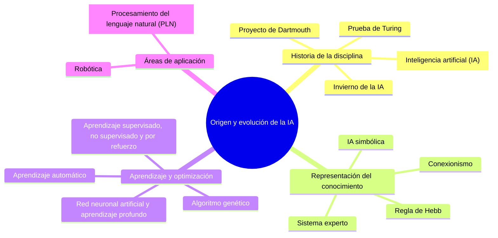
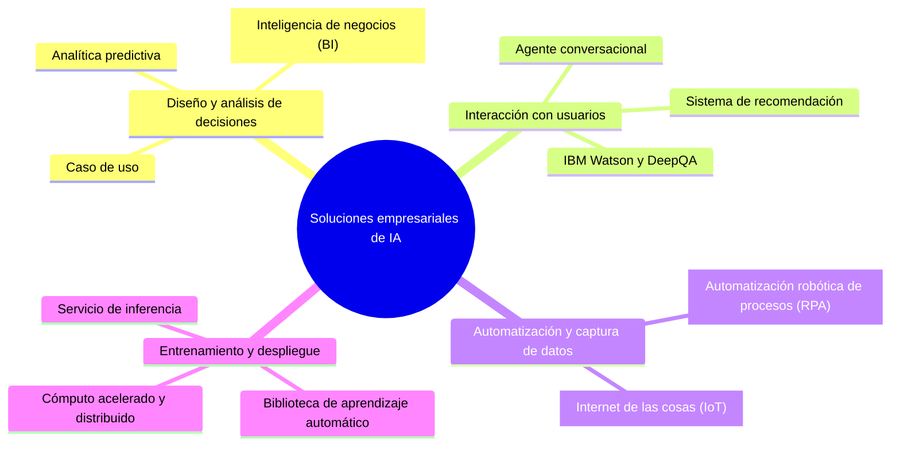
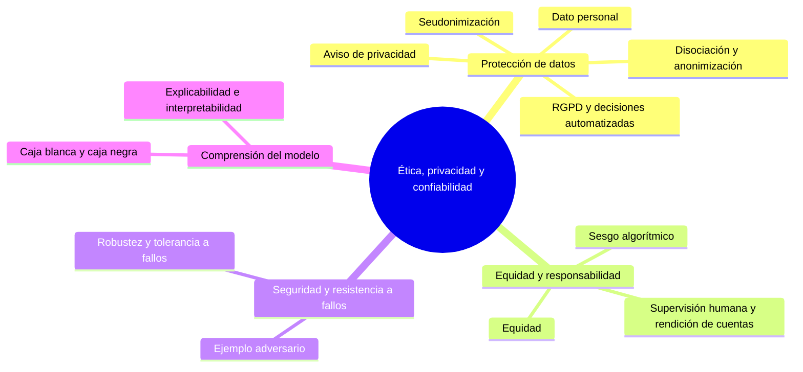
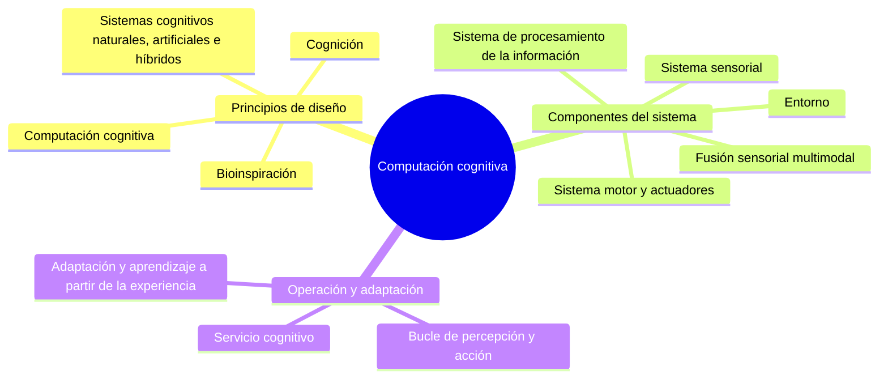
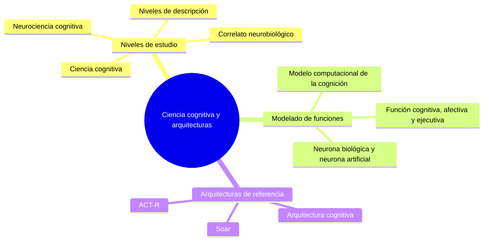
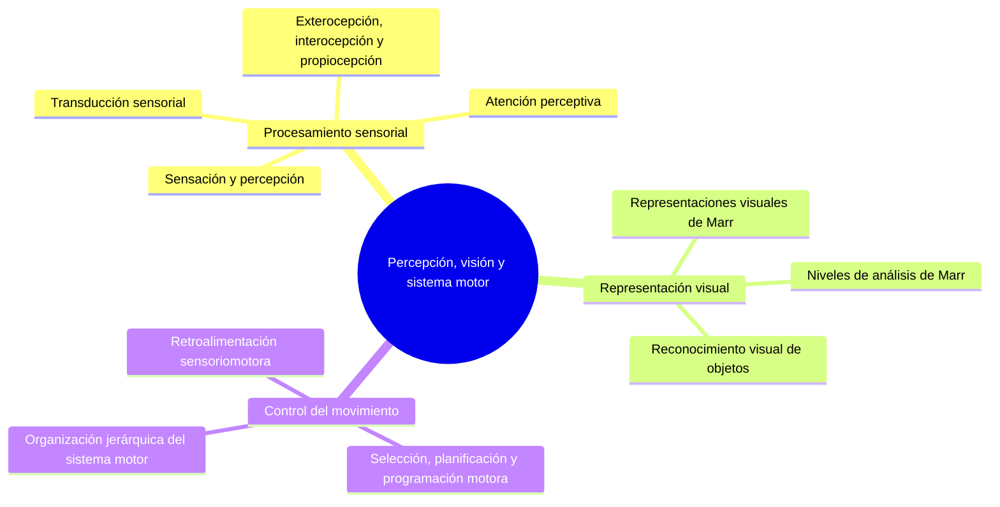
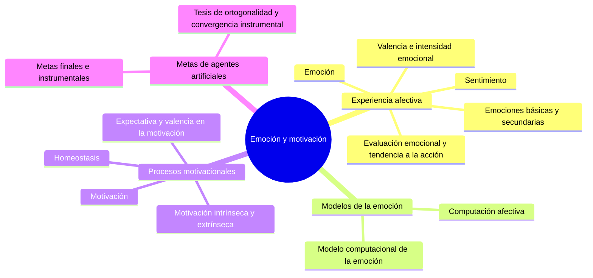
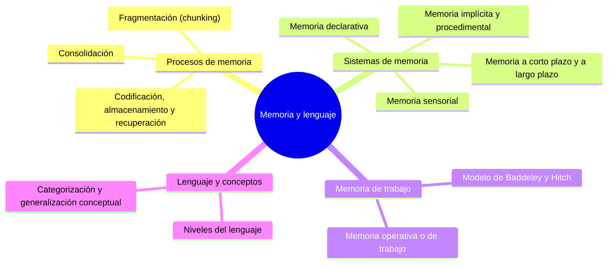
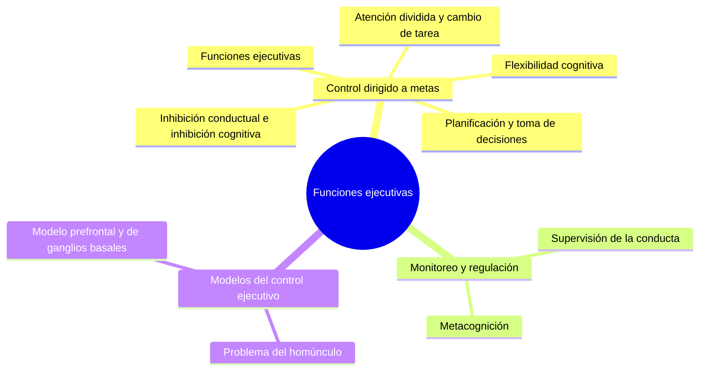

## Introducción

Imagina un robot al que le pides que lleve un libro a una mesa. Primero debe
interpretar la petición e identificar el libro. Después necesita recordar el
destino mientras avanza, seleccionar una ruta y cambiarla si detecta un
obstáculo. Cada tarea permite estudiar una capacidad distinta. La **computación
cognitiva** se ocupa también de cómo coordinarlas para que el sistema pueda
actuar según lo que percibe, recuerda y aprende.

Los primeros tres temas del glosario cubren los enfoques históricos de la
inteligencia artificial, su aplicación en las organizaciones y los riesgos
asociados con el uso de datos y modelos. Los seis siguientes recorren el diseño
de sistemas cognitivos y los modelos que ayudan a explicar la percepción, la
acción, la emoción, la motivación, la memoria, el lenguaje y el control
ejecutivo.

---

## Tabla de contenido

---

## 1. Origen y evolución de la inteligencia artificial

  

  

### Inteligencia artificial (IA)

Disciplina que estudia y construye sistemas capaces de realizar tareas como
reconocer patrones, inferir conclusiones, aprender de ejemplos o elegir acciones
para alcanzar un objetivo. La lógica aporta lenguajes para expresar reglas, la
estadística ayuda a trabajar con incertidumbre y la teoría de la decisión permite
comparar acciones según sus posibles consecuencias.

### Prueba de Turing

Evaluación inspirada en el juego de imitación de Alan Turing. En su versión
habitual, una persona conversa por escrito con interlocutores que no puede ver e
intenta distinguir a la máquina del interlocutor humano. El resultado describe
qué tan convincente fue la interacción dentro de las condiciones de la prueba
(Turing, 1950).

### Proyecto de Dartmouth

Proyecto de investigación de verano realizado en 1956. La propuesta de 1955 de
John McCarthy, Marvin Minsky, Nathaniel Rochester y Claude Shannon usó el término
"inteligencia artificial" para reunir problemas como el aprendizaje, el uso del
lenguaje y la formación de abstracciones (McCarthy et al., 1955).

### IA simbólica

Enfoque que representa objetos, relaciones y reglas mediante símbolos
manipulables. Por ejemplo, si una base indica que un libro pertenece a una
colección y que esa colección está en cierto estante, un programa puede inferir
dónde buscarlo.

### Sistema experto

Programa que utiliza conocimiento especializado para emitir conclusiones dentro
de un dominio. Un diseño clásico combina una **base de conocimiento**, que
contiene hechos y reglas, con un **motor de inferencia**, que decide cuáles
aplicar a los datos de un caso.

### Conexionismo

Enfoque que explica o implementa conductas mediante redes de unidades
interconectadas. Las representaciones pueden estar distribuidas entre muchas
unidades. El patrón de activación y la fuerza de las conexiones determinan cómo
responde la red a una entrada.

### Regla de Hebb

Principio de aprendizaje que relaciona el cambio en la fuerza de una conexión
con la actividad conjunta de las unidades que vincula. Ayuda a explicar cómo
puede surgir una asociación por cambios locales en una red.

### Aprendizaje automático

Conjunto de métodos que ajustan un modelo a partir de datos o experiencia para
realizar una tarea. La **generalización** es la capacidad de conservar un
desempeño adecuado en ejemplos nuevos de la población o el entorno de interés.

### Aprendizaje supervisado, no supervisado y por refuerzo

El **supervisado** aprende de ejemplos con resultados conocidos, como imágenes
con su etiqueta. El **no supervisado** busca estructura sin una variable
objetivo etiquetada, como grupos de observaciones parecidas. En el aprendizaje
**por refuerzo**, un agente aprende a elegir acciones mediante señales de
recompensa y considera también las consecuencias futuras de sus decisiones.

### Red neuronal artificial y aprendizaje profundo

Una red neuronal artificial encadena unidades parametrizadas que transforman
entradas en representaciones o salidas. En el **aprendizaje profundo**, la
composición de varias capas permite aprender representaciones en niveles. Un
modelo de visión puede combinar patrones locales hasta captar rasgos de objetos.

### Algoritmo genético

Método de optimización que mantiene una población de soluciones candidatas. La
función de aptitud permite compararlas. La selección favorece algunas de ellas y
la recombinación y la mutación generan variantes para explorar otras soluciones.

### Robótica

Disciplina que diseña sistemas físicos capaces de percibir y actuar mediante
sensores, controladores y actuadores. Un brazo industrial puede repetir una
trayectoria programada. Si además identifica piezas cambiantes con una cámara,
incorpora un componente de percepción artificial.

### Procesamiento del lenguaje natural (PLN)

Área que desarrolla métodos para analizar o generar lenguaje humano. Incluye
tareas como reconocer entidades en un texto, traducir una oración o determinar
la intención de una solicitud. Para ampliar estos conceptos, consulta el
[glosario de lingüística para PLN](/es/posts/2026/04/glosario-linguistica-nlp).

### Invierno de la IA

Periodo de contracción de las expectativas y del financiamiento para la
inteligencia artificial. La expresión se aplica a distintas etapas, entre ellas
la de mediados de los años setenta y la de finales de los ochenta, tras las
dificultades para llevar sistemas limitados a entornos más complejos.

## 2. Soluciones empresariales de inteligencia artificial

  

  

### Caso de uso

Descripción de una tarea, sus usuarios, los datos disponibles y el resultado
que se espera mejorar. "Predecir devoluciones" se vuelve un caso evaluable
cuando se define cuándo se emite la predicción, quién la usará y qué decisión
puede tomar a partir de ella.

### Analítica predictiva

Uso de datos para estimar un resultado desconocido o futuro. Un modelo puede
estimar la demanda semanal de un producto para apoyar el reabastecimiento. La
decisión también depende de factores como el costo de almacenamiento y el
tiempo de entrega.

### Inteligencia de negocios (BI)

Prácticas y herramientas que integran datos de una organización para consultar
indicadores y apoyar decisiones. Un tablero puede mostrar cómo cambiaron los
tiempos de entrega por región. Se le puede añadir un modelo que estime qué
pedidos se retrasarán.

### Sistema de recomendación

Sistema que selecciona u ordena opciones según señales sobre los artículos, la
persona o su interacción previa. Puede recomendar un libro a partir de su tema,
de lecturas anteriores o de patrones observados en personas con intereses
similares.

### Agente conversacional

Sistema que recibe y produce mensajes en lenguaje natural para cumplir una
tarea. Un asistente puede identificar una intención, extraer datos como una fecha
y pedir una aclaración si falta información para completar la solicitud.

### Automatización robótica de procesos (RPA)

Automatización de operaciones repetitivas en aplicaciones de software, como
copiar campos de un formulario a un sistema de registro. Puede incorporar IA
para una parte de la tarea, por ejemplo, extraer los campos de una factura
escaneada antes de registrar sus valores.

### Internet de las cosas (IoT)

Red de dispositivos que recopilan y comparten mediciones o reciben órdenes. Los
datos de sensores conectados pueden alimentar un modelo de mantenimiento
predictivo que estima el riesgo de falla de un equipo.

### Biblioteca de aprendizaje automático

Paquete que proporciona implementaciones reutilizables para entrenar y evaluar
modelos. `scikit-learn` reúne estimadores y herramientas de preprocesamiento,
validación y selección de modelos (Scikit-learn Developers, s. f.). `Keras`
ofrece interfaces para construir y entrenar redes neuronales (Keras Team,
s. f.).

### Cómputo acelerado y distribuido

El cómputo acelerado delega operaciones, como productos de matrices, a
dispositivos especializados como una GPU. El cómputo distribuido reparte datos o
trabajo entre varios procesos o equipos. Ambos pueden combinarse para entrenar
un modelo que exceda la capacidad de un solo dispositivo.

### Servicio de inferencia

Componente que recibe datos nuevos, ejecuta un modelo entrenado y devuelve su
salida, por ejemplo, mediante una interfaz de programación de aplicaciones
(API). La aplicación que recibe la respuesta puede usarla como sugerencia,
combinarla con reglas o enviarla a revisión humana.

### IBM Watson y DeepQA

En el sistema de preguntas y respuestas que IBM presentó en _Jeopardy!_,
DeepQA analizaba cada pregunta, generaba respuestas candidatas y las ordenaba
al combinar evidencias y estimar la confianza. Permite ver cómo un sistema de
lenguaje puede integrar varios métodos antes de emitir una respuesta (High,
2012).

## 3. Implicaciones éticas, privacidad y confiabilidad

  

  

### Dato personal

Información concerniente a una persona identificada o identificable. Una tabla
sin nombres puede seguir conteniendo datos personales si la combinación de su
contenido con otros registros permite identificar a alguien.

### Aviso de privacidad

Documento que informa a las personas sobre el tratamiento de sus datos
personales. En México, la Ley Federal de Protección de Datos Personales en
Posesión de los Particulares establece el marco para el tratamiento por parte de
particulares (Ley Federal de Protección de Datos Personales en Posesión de los
Particulares, 2025).

### RGPD y decisiones automatizadas

El Reglamento General de Protección de Datos de la Unión Europea regula el
tratamiento de datos personales. Su artículo 22 establece límites y excepciones
para decisiones tomadas de forma exclusivamente automatizada que producen
efectos jurídicos o afectan a una persona de manera igualmente significativa.
En ciertos supuestos, el reglamento exige que la persona pueda solicitar
intervención humana e impugnar la decisión (Reglamento (UE) 2016/679, 2016).

### Disociación y anonimización

La disociación transforma los datos personales para impedir que se vinculen a
su titular o se utilicen para identificarlo. En una anonimización, el riesgo
de reidentificación se evalúa también frente a información auxiliar. Quitar
nombres puede ser insuficiente si quedan fechas, ubicaciones y otros atributos
distintivos.

### Seudonimización

Sustitución o transformación de identificadores para que atribuir los registros
a una persona requiera información adicional, como una tabla de equivalencias
que se conserva por separado. La posibilidad de recuperar el vínculo distingue
este procedimiento de una anonimización efectiva.

### Sesgo algorítmico

Patrón sistemático de errores o decisiones que puede aparecer por la forma de
recolectar los datos, las etiquetas disponibles, el objetivo elegido o el
contexto de uso. Un buen resultado promedio puede ocultar errores frecuentes en
un grupo poco representado.

### Equidad

Propiedad que se evalúa según los daños y el contexto de una decisión. En un
sistema de asignación, interesa saber quién recibe el beneficio y a quién
afectan los falsos rechazos. El criterio de evaluación debe corresponder con la
decisión que se toma.

### Supervisión humana y rendición de cuentas

La supervisión humana define cuándo una persona revisa, corrige o detiene una
decisión automatizada. La rendición de cuentas asigna responsables y conserva
evidencia para reconstruir decisiones, investigar incidentes y responder ante
las personas afectadas.

### Ejemplo adversario

Entrada alterada deliberadamente que busca inducir un error en un modelo.
Evaluar el comportamiento ante este tipo de entradas ayuda a determinar cuándo
el sistema debe rechazar un resultado o solicitar una verificación adicional.

### Robustez y tolerancia a fallos

La robustez describe en qué medida se conserva el desempeño frente a
perturbaciones o cambios en las entradas. La tolerancia a fallos se refiere a
cómo sigue operando el sistema al fallar un componente. Un robot puede mantener
una detección confiable con poca luz y entrar a un modo seguro si pierde la
señal de una cámara.

### Caja blanca y caja negra

Un modelo de caja blanca expone una estructura que se puede inspeccionar
directamente, como un árbol de decisión pequeño. En un modelo de caja negra, la
ruta de cálculo o su escala dificultan entender una decisión particular. Que un
modelo sea inspeccionable facilita la revisión de su lógica.

### Explicabilidad e interpretabilidad

La explicabilidad se ocupa de comunicar cómo se produjo un resultado. La
interpretabilidad se ocupa de qué significa ese resultado en el contexto de la
tarea (Tabassi, 2023). Una explicación debe ser comprensible para su audiencia,
describir con fidelidad el proceso y reconocer sus límites (Phillips et al.,
2021).

## 4. Computación cognitiva y sistemas cognitivos

  

  

### Cognición

Conjunto de procesos mediante los cuales un organismo o sistema adquiere,
organiza y utiliza información. En una tarea concreta, percibir un objeto,
reconocerlo y recordar cómo se utiliza son procesos distintos que contribuyen a
una respuesta coordinada.

### Computación cognitiva

Diseño de sistemas informáticos que integran capacidades relacionadas con la
cognición para actuar en un contexto. Por ejemplo, un robot de servicio puede
interpretar una solicitud, recuperar información de tareas anteriores y
ajustar la ejecución conforme cambia su entorno.

### Sistemas cognitivos naturales, artificiales e híbridos

Un sistema **natural** es un organismo cuyas funciones cognitivas se estudian
como parte de su interacción con el entorno. Un sistema **artificial**
implementa algunas de esas funciones mediante software o dispositivos físicos.
En un sistema **híbrido**, personas y componentes artificiales participan en un
mismo ciclo de observación, decisión y acción.

### Bioinspiración

Uso de un principio observado en organismos vivos como punto de partida para un
diseño artificial. Un sistema de visión, por ejemplo, puede priorizar regiones
de una imagen según la tarea. El principio funcional guía el diseño y su
implementación puede usar mecanismos distintos de los biológicos.

### Entorno

Medio físico o virtual en el que actúa el sistema. Incluye elementos con los
que puede interactuar, como personas, obstáculos o servicios informáticos. El
diseño del sistema depende de qué cambios en el entorno importan para la tarea
y de cuáles puede detectar.

### Sistema sensorial

Conjunto de medios que obtienen y codifican entradas. En un robot puede incluir
cámaras, micrófonos y sensores de distancia. En un agente de software, las
entradas pueden provenir de mensajes, formularios o eventos.

### Sistema de procesamiento de la información

Conjunto de mecanismos que transforman las entradas en representaciones útiles,
recuperan información almacenada, evalúan la situación y seleccionan respuestas.
Por ejemplo, un mapa y la posición estimada del robot permiten determinar qué
ruta puede tomar.

### Sistema motor y actuadores

Subsistema que convierte una decisión en una acción. En un robot, un actuador
puede mover una rueda o ajustar la posición de una pinza. La salida equivalente
en un sistema informático puede ser una respuesta de voz o una operación que
modifica el estado de otro servicio.

### Fusión sensorial multimodal

Combinación de información procedente de distintas fuentes. Una cámara aporta
rasgos visuales de un objeto y un sensor de distancia ayuda a ubicarlo. La
combinación permite resolver incertidumbres que persisten en una sola señal.

### Bucle de percepción y acción

Proceso en el que el sistema observa el entorno, actúa y vuelve a observar para
comprobar el efecto de su acción. Cuando un robot se acerca a un libro, obtiene
una nueva vista que puede usar para ajustar su trayectoria.

### Adaptación y aprendizaje a partir de la experiencia

La adaptación consiste en ajustar la conducta cuando cambian el entorno o las
condiciones de trabajo. El aprendizaje incorpora regularidades de experiencias
previas que pueden mejorar decisiones posteriores. Un robot puede esquivar un
obstáculo en el momento y aprender con el tiempo qué rutas suelen bloquearse.

### Servicio cognitivo

Componente accesible desde una aplicación que realiza una tarea como reconocer
texto, transcribir audio o analizar imágenes. Una arquitectura puede combinar
varios servicios cognitivos con memoria, reglas de decisión y control de
acciones.

## 5. Ciencia cognitiva y arquitecturas

  

  

### Ciencia cognitiva

Estudio interdisciplinario de la mente y la cognición. Combina preguntas y
métodos de la psicología, la neurociencia, la lingüística, la filosofía, la
antropología y la inteligencia artificial. Un mismo problema, como reconocer
una palabra, puede estudiarse mediante el comportamiento, la actividad neuronal
y la simulación computacional.

### Neurociencia cognitiva

Disciplina que investiga cómo la actividad del sistema nervioso se relaciona con
procesos como la atención, la memoria o el lenguaje. Puede combinar las
mediciones cerebrales con tareas controladas para evaluar hipótesis sobre los
mecanismos implicados.

### Correlato neurobiológico

Patrón medible de actividad, estructura o conectividad del sistema nervioso
asociado con un proceso mental. Una región cuya actividad cambia durante una
tarea ofrece una pista sobre el mecanismo. Para establecer su papel causal se
necesita evidencia adicional.

### Niveles de descripción

Perspectivas desde las que se estudia un mismo fenómeno. Para explicar que una
persona recuerda una instrucción, se pueden analizar su desempeño observable,
las operaciones de memoria que propone un modelo y los circuitos que podrían
implementarlas. Conectar esas explicaciones es un problema de investigación.

### Modelo computacional de la cognición

Implementación de una hipótesis sobre un proceso cognitivo. Hace explícitos
los estados y las operaciones del modelo. Sus resultados, como los tiempos de
respuesta o los tipos de errores, se pueden comparar con observaciones para
evaluar la hipótesis.

### Función cognitiva, afectiva y ejecutiva

Una función **cognitiva** permite percibir, recordar o interpretar información.
Una función **afectiva** contribuye a evaluar la relevancia de lo que sucede y a
orientar la conducta. Una función **ejecutiva** coordina estos procesos según las
metas y restricciones de la tarea.

### Neurona biológica y neurona artificial

La neurona biológica es una célula que recibe, integra y transmite señales. La
neurona artificial es una unidad de cálculo que suele combinar entradas
ponderadas y aplicar una función de activación. La abstracción permite estudiar
cómo muchas unidades conectadas representan y transforman información.

### Arquitectura cognitiva

Marco computacional que define componentes relativamente estables, como
memoria y selección de acciones, y las reglas con que interactúan. Los modelos
construidos sobre la misma arquitectura pueden variar en su conocimiento de la
tarea y compartir mecanismos de aprendizaje o recuperación.

### ACT-R

Arquitectura cognitiva que organiza la actividad mediante módulos y zonas de
intercambio llamadas _buffers_. Las reglas de producción comprueban el contenido
de esos _buffers_ y actúan sobre ellos. La arquitectura permite formular
predicciones como cuánto tarda una persona en recuperar una información
(Budiu, s. f.).

### Soar

Arquitectura cognitiva que representa el estado de una tarea y selecciona
operadores para modificarlo. Si la información actual resulta insuficiente para
elegir un operador, puede abrir un subproblema y aprender reglas a partir de su
resolución (University of Michigan, s. f.).

## 6. Percepción, visión y sistema motor

  

  

### Sensación y percepción

La sensación comienza con la detección de un estímulo, como la luz que llega a
la retina. La percepción organiza e interpreta esa información. Por ejemplo,
reconoces un objeto aunque su imagen cambie al observarlo desde otro ángulo.

### Transducción sensorial

Conversión de la energía de un estímulo en una señal que puede procesar un
sistema sensorial. Los fotorreceptores convierten la luz en cambios eléctricos.
Una cámara realiza una conversión funcionalmente comparable mediante sensores
electrónicos.

### Exterocepción, interocepción y propiocepción

La **exterocepción** aporta señales del exterior, como luz y sonido. La
**interocepción** informa sobre el estado interno del cuerpo, como la
distensión del estómago. La **propiocepción** aporta información sobre posición y
movimiento corporal y permite ajustar una acción aun cuando no la estés viendo.

### Atención perceptiva

Selección de la información sensorial que recibe prioridad de procesamiento. Al
buscar un libro en un estante, el color o el lugar esperado del lomo orientan la
mirada y reducen la cantidad de información que se examina en detalle.

### Niveles de análisis de Marr

David Marr distinguió el nivel **computacional**, que pregunta qué problema
resuelve un sistema y por qué, el **algorítmico**, que describe las
representaciones y transformaciones, y el de **implementación**, que describe
cómo se realizan físicamente. Los tres niveles formulan preguntas distintas
sobre una misma función (Marr, 2010).

### Representaciones visuales de Marr

| Representación                         | Información que hace explícita                                                             |
| :------------------------------------- | :----------------------------------------------------------------------------------------- |
| **Bosquejo inicial** (_primal sketch_) | Cambios de intensidad y estructura local de la imagen, como bordes y agrupaciones.         |
| **Bosquejo 2.5D**                      | Profundidad y orientación de las superficies visibles desde la perspectiva del observador. |
| **Modelo 3D**                          | Estructura de la forma en un sistema de referencia centrado en el objeto.                  |

El bosquejo 2.5D de una taza describe las superficies visibles desde tu
posición. El modelo centrado en el objeto permite representar el asa en relación
con el cuerpo de la taza aunque cambie el punto de vista (Marr, 1977).

### Reconocimiento visual de objetos

Identificación de un objeto a partir de información visual. Detectar contornos
ayuda a describir su forma. Reconocer que el objeto es una taza permite además
recuperar conocimiento de la memoria semántica, como su función habitual.

### Organización jerárquica del sistema motor

Distintos niveles del sistema motor contribuyen a traducir una intención en
movimiento. Una meta como tomar un libro implica alcanzar el estante, orientar
la mano y ajustar la fuerza de agarre. En el proceso intervienen circuitos
corticales y subcorticales, vías espinales y señales sensoriales.

### Selección, planificación y programación motora

La **selección** determina qué acción conviene realizar. La **planificación**
organiza los pasos para cumplirla. La **programación motora** prepara los
parámetros de los movimientos, como su dirección y secuencia, para ejecutarlos.

### Retroalimentación sensoriomotora

Información que vuelve al sistema de control durante o después de una acción.
Si el libro se desliza, el tacto informa del cambio y permite ajustar la fuerza
de agarre. Así, la ejecución puede corregirse conforme llegan nuevas señales.

## 7. Emoción y motivación

  

  

### Emoción

Respuesta que integra la evaluación de un acontecimiento, cambios corporales,
expresión y tendencias a actuar. El miedo, por ejemplo, puede modificar la
atención hacia una amenaza y favorecer conductas como detenerse o alejarse.

### Sentimiento

Experiencia subjetiva de un estado afectivo. El rostro, la voz y los cambios
fisiológicos pueden aportar indicios, y su interpretación depende de la persona
y la situación.

### Valencia e intensidad emocional

La **valencia** indica el carácter agradable o desagradable de una experiencia.
La **intensidad** describe el grado con que se manifiesta. Un miedo intenso
puede tener valencia desagradable y contribuir a una respuesta protectora.

### Emociones básicas y secundarias

Algunas teorías distinguen un conjunto de emociones básicas, como miedo, alegría
y tristeza, de emociones que requieren evaluaciones sociales o autorreferentes
más elaboradas, como culpa y vergüenza. Los criterios y las listas varían según
el modelo.

### Evaluación emocional y tendencia a la acción

La evaluación atribuye importancia a un acontecimiento según el contexto y las
metas. La tendencia a la acción es la predisposición que puede surgir de esa
evaluación. La misma interrupción puede favorecer la búsqueda de ayuda o el
cambio de estrategia según lo que el agente esté intentando lograr.

### Computación afectiva

Área que estudia sistemas que reconocen, representan o responden a señales
afectivas. Un sistema educativo puede ajustar el ritmo de una explicación
cuando la persona reporta confusión. Si se usan señales indirectas, como la
prosodia, la estimación depende del contexto y puede ser ambigua (Picard &
Klein, 2002).

### Modelo computacional de la emoción

Modelo que representa componentes funcionales de una emoción mediante variables
que intervienen en la selección de respuestas. Puede estimar, por ejemplo, el
grado de frustración simulado cuando se interrumpe reiteradamente el progreso
hacia una meta y usar ese estado para ajustar el comportamiento.

### Motivación

Conjunto de procesos que activan, orientan y sostienen la conducta hacia una
meta. Ayuda a explicar por qué se inicia una actividad, a qué se dedica esfuerzo
y cuándo se abandona o cambia de estrategia.

### Motivación intrínseca y extrínseca

En la motivación **intrínseca**, realizar la actividad tiene valor en sí mismo,
como explorar por curiosidad. En la **extrínseca**, la actividad contribuye a un
resultado separable, como obtener una calificación. Ambas pueden participar en
una misma decisión.

### Homeostasis

Regulación que mantiene una variable dentro de un intervalo funcional pese a
perturbaciones. En un diseño bioinspirado, un robot puede vigilar su nivel de
energía y dar prioridad a recargarse cuando detecta que la batería se acerca a un
umbral.

### Expectativa y valencia en la motivación

La **expectativa** expresa la posibilidad percibida de conseguir un resultado y
la **valencia** expresa cuánto se valora ese resultado. En un modelo sencillo,
su producto explica por qué una meta atractiva puede motivar poco si se juzga
casi imposible de alcanzar.

### Metas finales e instrumentales

Una meta **final** especifica lo que el agente busca conseguir. Una meta
**instrumental** facilita lograr otra meta. Para un robot encargado de repartir
libros, mantener la batería cargada puede ser instrumental para completar la
entrega.

### Tesis de ortogonalidad y convergencia instrumental

La **ortogonalidad** plantea que las capacidades de un agente y sus metas
finales pueden variar de forma independiente. La **convergencia instrumental**
plantea que agentes con objetivos finales distintos podrían adoptar metas
intermedias similares cuando les resultan útiles. Son tesis sobre agentes
posibles, formuladas con supuestos sobre sus capacidades y entornos (Bostrom,
2012).

## 8. Memoria y lenguaje

  

  

### Codificación, almacenamiento y recuperación

La **codificación** transforma una experiencia en una representación que puede
conservarse. El **almacenamiento** mantiene esa representación y la
**recuperación** permite acceder a ella. Un problema al recordar una instrucción
puede surgir en cualquiera de estos procesos.

### Memoria sensorial

Retención breve de rastros asociados con una modalidad sensorial. La memoria
icónica conserva información visual durante un periodo corto y la ecoica
retiene aspectos de señales auditivas. Estos rastros permiten que parte de la
información se seleccione para seguir procesándola.

### Memoria a corto plazo y a largo plazo

La memoria **a corto plazo** describe la retención temporal de una cantidad
limitada de información. La memoria **a largo plazo** permite conservar
conocimientos, experiencias y habilidades durante periodos más extensos. El
modelo de Atkinson y Shiffrin distingue estos dos almacenes y uno sensorial.

### Memoria declarativa

Memoria de hechos y acontecimientos que pueden evocarse de forma explícita. Se
distingue entre la **semántica**, que contiene conocimiento general, y la
**episódica**, que conserva acontecimientos situados. Saber qué es una
biblioteca y recordar tu última visita son ejemplos de cada tipo.

### Memoria implícita y procedimental

La memoria implícita se manifiesta en cambios de desempeño que pueden ocurrir
sin recordar conscientemente el aprendizaje. La memoria procedimental es una
de sus formas y se observa al ejecutar habilidades adquiridas mediante la
práctica, como teclear o montar en bicicleta.

### Memoria operativa o de trabajo

Sistema de capacidad limitada que mantiene y manipula información relevante para
una tarea en curso. Si comparas dos rutas, la memoria de trabajo te permite
mantener una opción activa mientras revisas los pasos de la otra.

### Modelo de Baddeley y Hitch

El modelo inicial de memoria operativa propone un **ejecutivo central** que
coordina los recursos de atención y dos subsistemas de almacenamiento temporal.
Baddeley incorporó posteriormente un cuarto componente para explicar cómo se
integran contenidos de distintas fuentes (Baddeley, 2000).

| Componente               | Función                                                                                   |
| :----------------------- | :---------------------------------------------------------------------------------------- |
| **Ejecutivo central**    | Coordina la atención y el uso de los recursos de memoria de trabajo.                      |
| **Bucle fonológico**     | Mantiene información verbal o sonora, por ejemplo, mediante la repetición mental.         |
| **Agenda visuoespacial** | Mantiene y manipula información sobre formas y relaciones espaciales.                     |
| **Retén episódico**      | Integra temporalmente información de distintas modalidades y de la memoria a largo plazo. |

### Fragmentación (_chunking_)

Agrupación de elementos en unidades significativas. Por ejemplo, se pueden
recordar las letras "UNIR" como una unidad si la palabra ya es familiar. La
capacidad aparente cambia con la organización del material y el conocimiento
previo.

### Consolidación

Proceso por el cual un recuerdo adquiere mayor estabilidad. El hipocampo y
otras estructuras del lóbulo temporal medial participan en la formación de
nuevos recuerdos declarativos. Esos recuerdos dependen de redes más amplias
para su conservación y recuperación.

### Niveles del lenguaje

La **fonética** estudia cómo se producen y perciben los sonidos. La
**fonología** estudia cómo se organizan en una lengua. La **morfología** analiza
cómo se forman las palabras y la **sintaxis**, cómo se combinan. La
**semántica** aborda su significado y la **pragmática**, cómo el contexto
orienta su interpretación.

### Categorización y generalización conceptual

La categorización asigna una experiencia nueva a una clase y permite recuperar
conocimiento asociado. Reconocer como silla un mueble que nunca habías visto
sugiere cómo puedes usarlo. Un modelo computacional puede representar las
propiedades compartidas y usar la etiqueta para comunicar la categoría.

## 9. Funciones ejecutivas y supervisión de la conducta

  

  

### Funciones ejecutivas

Procesos de control que guían la conducta hacia metas, especialmente cuando la
situación exige mantener una instrucción, resistir una respuesta habitual o
cambiar de estrategia. La memoria de trabajo, la inhibición y la flexibilidad
contribuyen a tareas como planear o tomar decisiones.

### Inhibición conductual e inhibición cognitiva

La **conductual** permite detener una respuesta dominante o automática. La
**cognitiva** reduce la interferencia de información irrelevante en la tarea.
Al seguir una ruta nueva, puedes frenar antes de dar la vuelta habitual y dejar
de prestar atención a las indicaciones de la ruta anterior.

### Flexibilidad cognitiva

Capacidad de cambiar de regla, perspectiva o estrategia cuando cambia la
situación. Si una ruta queda bloqueada, el objetivo se mantiene y se
reconsideran los pasos disponibles para alcanzarlo.

### Planificación y toma de decisiones

Planificar es organizar operaciones y metas intermedias tomando en cuenta las
restricciones. Decidir es elegir entre las alternativas que se tienen
disponibles. Para entregar un libro, puedes comparar rutas y luego ordenar las
acciones necesarias para recogerlo, trasladarlo y colocarlo.

### Atención dividida y cambio de tarea

La atención dividida distribuye recursos entre demandas que coinciden. Cuando dos
tareas requieren el mismo recurso, alternar entre ellas puede requerir recuperar
el contexto previo y aumentar el tiempo de respuesta o los errores.

### Supervisión de la conducta

Seguimiento de la ejecución para detectar errores, conflictos o desvíos de la
meta. Si una acción produce un resultado distinto del esperado, se puede
detener la secuencia, actualizar lo que se sabe de la situación y volver a
elegir un plan.

### Metacognición

Monitoreo y regulación de los propios procesos cognitivos. Por ejemplo, notar
que no recuerdas un paso y consultar la instrucción antes de continuar. Un
sistema artificial puede implementar mecanismos de monitoreo que detecten cuándo
una predicción queda fuera de sus condiciones de uso y soliciten revisión.

### Problema del homúnculo

Dificultad de explicar el control atribuyéndolo a un supervisor interno que
supuestamente sabe qué hacer. La explicación queda incompleta hasta modelar qué
información recibe ese supervisor, cómo selecciona respuestas y cómo aprende
cuándo intervenir.

### Modelo prefrontal y de ganglios basales

Hazy et al. (2007) describen un modelo en el que los ganglios basales modulan
cuándo actualizar o usar representaciones en la memoria de trabajo. En la
simulación, el aprendizaje por refuerzo ajusta la apertura de esas compuertas
según los resultados de la tarea. Así se puede estudiar el control ejecutivo
mediante operaciones concretas de actualización y selección.

## Mapa mental general

```mermaid
mindmap
  root((Inteligencia artificial y computación cognitiva))
    Origen y evolución de la IA
      Historia de la disciplina
        n1_1["Inteligencia artificial (IA)"]
        Prueba de Turing
        Proyecto de Dartmouth
        Invierno de la IA
      Representación del conocimiento
        IA simbólica
        Sistema experto
        Conexionismo
        Regla de Hebb
      Aprendizaje y optimización
        Aprendizaje automático
        Aprendizaje supervisado, no supervisado y por refuerzo
        Red neuronal artificial y aprendizaje profundo
        Algoritmo genético
      Áreas de aplicación
        Robótica
        n1_13["Procesamiento del lenguaje natural (PLN)"]
    Soluciones empresariales de IA
      Diseño y análisis de decisiones
        Caso de uso
        Analítica predictiva
        n2_3["Inteligencia de negocios (BI)"]
      Interacción con usuarios
        Sistema de recomendación
        Agente conversacional
        IBM Watson y DeepQA
      Automatización y captura de datos
        n2_6["Automatización robótica de procesos (RPA)"]
        n2_7["Internet de las cosas (IoT)"]
      Entrenamiento y despliegue
        Biblioteca de aprendizaje automático
        Cómputo acelerado y distribuido
        Servicio de inferencia
    Ética, privacidad y confiabilidad
      Protección de datos
        Dato personal
        Aviso de privacidad
        RGPD y decisiones automatizadas
        Disociación y anonimización
        Seudonimización
      Equidad y responsabilidad
        Sesgo algorítmico
        Equidad
        Supervisión humana y rendición de cuentas
      Seguridad y resistencia a fallos
        Ejemplo adversario
        Robustez y tolerancia a fallos
      Comprensión del modelo
        Caja blanca y caja negra
        Explicabilidad e interpretabilidad
    Computación cognitiva
      Principios de diseño
        Cognición
        Computación cognitiva
        Sistemas cognitivos naturales, artificiales e híbridos
        Bioinspiración
      Componentes del sistema
        Entorno
        Sistema sensorial
        Sistema de procesamiento de la información
        Sistema motor y actuadores
        Fusión sensorial multimodal
      Operación y adaptación
        Bucle de percepción y acción
        Adaptación y aprendizaje a partir de la experiencia
        Servicio cognitivo
    Ciencia cognitiva y arquitecturas
      Niveles de estudio
        Ciencia cognitiva
        Neurociencia cognitiva
        Correlato neurobiológico
        Niveles de descripción
      Modelado de funciones
        Modelo computacional de la cognición
        Función cognitiva, afectiva y ejecutiva
        Neurona biológica y neurona artificial
      Arquitecturas de referencia
        Arquitectura cognitiva
        ACT-R
        Soar
    Percepción, visión y sistema motor
      Procesamiento sensorial
        Sensación y percepción
        Transducción sensorial
        Exterocepción, interocepción y propiocepción
        Atención perceptiva
      Representación visual
        Niveles de análisis de Marr
        Representaciones visuales de Marr
        Reconocimiento visual de objetos
      Control del movimiento
        Organización jerárquica del sistema motor
        Selección, planificación y programación motora
        Retroalimentación sensoriomotora
    Emoción y motivación
      Experiencia afectiva
        Emoción
        Sentimiento
        Valencia e intensidad emocional
        Emociones básicas y secundarias
        Evaluación emocional y tendencia a la acción
      Modelos de la emoción
        Computación afectiva
        Modelo computacional de la emoción
      Procesos motivacionales
        Motivación
        Motivación intrínseca y extrínseca
        Homeostasis
        Expectativa y valencia en la motivación
      Metas de agentes artificiales
        Metas finales e instrumentales
        Tesis de ortogonalidad y convergencia instrumental
    Memoria y lenguaje
      Procesos de memoria
        Codificación, almacenamiento y recuperación
        n8_8["Fragmentación (chunking)"]
        Consolidación
      Sistemas de memoria
        Memoria sensorial
        Memoria a corto plazo y a largo plazo
        Memoria declarativa
        Memoria implícita y procedimental
      Memoria de trabajo
        Memoria operativa o de trabajo
        Modelo de Baddeley y Hitch
      Lenguaje y conceptos
        Niveles del lenguaje
        Categorización y generalización conceptual
    Funciones ejecutivas
      Control dirigido a metas
        Funciones ejecutivas
        Inhibición conductual e inhibición cognitiva
        Flexibilidad cognitiva
        Planificación y toma de decisiones
        Atención dividida y cambio de tarea
      Monitoreo y regulación
        Supervisión de la conducta
        Metacognición
      Modelos del control ejecutivo
        Problema del homúnculo
        Modelo prefrontal y de ganglios basales
```

  

  

## Fuentes verificadas

- Baddeley, A. (2000). The episodic buffer: A new component of working memory?
  _Trends in Cognitive Sciences, 4_(11), 417–423.
  <a href="https://doi.org/10.1016/S1364-6613(00)01538-2" target="_blank">
    https://doi.org/10.1016/S1364-6613(00)01538-2
  </a>
- Bostrom, N. (2012). The superintelligent will: Motivation and instrumental
  rationality in advanced artificial agents. _Minds and Machines, 22_(2),
  71–85.
  <a href="https://nickbostrom.com/superintelligentwill.pdf" target="_blank">
    https://doi.org/10.1007/s11023-012-9281-3
  </a>
- Budiu, R. (s. f.). _About_. ACT-R, Carnegie Mellon University.
  <a href="https://act-r.psy.cmu.edu/about/" target="_blank">
    Descripción de la arquitectura
  </a>
- Hazy, T. E., Frank, M. J., & O'Reilly, R. C. (2007). Towards an executive
  without a homunculus: Computational models of the prefrontal cortex/basal
  ganglia system. _Philosophical Transactions of the Royal Society B:
  Biological Sciences, 362_(1485), 1601–1613.
  <a href="https://pmc.ncbi.nlm.nih.gov/articles/PMC2440774/" target="_blank">
    https://doi.org/10.1098/rstb.2007.2055
  </a>
- High, R. (2012).
  <a
    href="https://www.redbooks.ibm.com/abstracts/redp4955.html"
    target="_blank"
  >
    <em>
      The era of cognitive systems: An inside look at IBM Watson and how it
      works
    </em>
  </a>
  . IBM Redbooks.
- Keras Team. (s. f.).
  <a href="https://keras.io/guides/" target="_blank">
    <em>Developer guides</em>
  </a>
  . Keras.
- Ley Federal de Protección de Datos Personales en Posesión de los Particulares.
  (2025, 20 de marzo). _Diario Oficial de la Federación_ (México).
  <a
    href="https://www.diputados.gob.mx/LeyesBiblio/pdf/LFPDPPP.pdf"
    target="_blank"
  >
    Texto vigente
  </a>
  .
- Marr, D. (1977).
  <a
    href="https://dspace.mit.edu/entities/publication/de6ecdbc-779e-4159-a523-e8177a321a8c"
    target="_blank"
  >
    <em>Representing visual information</em>
  </a>
  (AI Memo 415). Massachusetts Institute of Technology.
- Marr, D. (2010).
  <a href="https://mitpress.mit.edu/9780262288989/vision/" target="_blank">
    <em>
      Vision: A computational investigation into the human representation and
      processing of visual information
    </em>
  </a>
  . The MIT Press. (Obra original publicada en 1982).
- McCarthy, J., Minsky, M. L., Rochester, N., & Shannon, C. E. (1955, 31 de
  agosto).
  <a
    href="https://www-formal.stanford.edu/jmc/history/dartmouth/dartmouth.html"
    target="_blank"
  >
    <em>
      A proposal for the Dartmouth Summer Research Project on Artificial
      Intelligence
    </em>
  </a>
  [Propuesta de investigación].
- Phillips, P. J., Hahn, C. A., Fontana, P. C., Yates, A. N., Greene, K.,
  Broniatowski, D. A., & Przybocki, M. A. (2021). _Four principles of
  explainable artificial intelligence_ (NISTIR 8312). National Institute of
  Standards and Technology.
  <a
    href="https://nvlpubs.nist.gov/nistpubs/ir/2021/NIST.IR.8312.pdf"
    target="_blank"
  >
    https://doi.org/10.6028/NIST.IR.8312
  </a>
- Picard, R. W., & Klein, J. (2002). Computers that recognise and respond to
  user emotion: Theoretical and practical implications. _Interacting with
  Computers, 14_(2), 141–169.
  <a
    href="https://vismod.media.mit.edu/tech-reports/TR-538.pdf"
    target="_blank"
  >
    Versión de acceso abierto del MIT Media Lab
  </a>
  .
- Reglamento (UE) 2016/679 del Parlamento Europeo y del Consejo (Reglamento
  General de Protección de Datos). (2016, 27 de abril). _Diario Oficial de la
  Unión Europea, L 119_, 1–88.
  <a href="https://eur-lex.europa.eu/eli/reg/2016/679/oj/spa" target="_blank">
    Texto del reglamento
  </a>
- Scikit-learn Developers. (s. f.).
  <a href="https://scikit-learn.org/stable/user_guide.html" target="_blank">
    <em>User guide</em>
  </a>
  . Scikit-learn.
- Tabassi, E. (2023). _Artificial intelligence risk management framework_
  (AI RMF 1.0). National Institute of Standards and Technology.
  <a
    href="https://www.nist.gov/publications/artificial-intelligence-risk-management-framework-ai-rmf-10"
    target="_blank"
  >
    https://doi.org/10.6028/NIST.AI.100-1
  </a>
- Turing, A. M. (1950). Computing machinery and intelligence. _Mind, 59_(236),
  433–460.
  <a
    href="https://www2.cs.sfu.ca/~vaughan/teaching/889/papers/turing1950.html"
    target="_blank"
  >
    Versión de acceso abierto de Simon Fraser University
  </a>
  .
- University of Michigan. (s. f.).
  <a
    href="https://soar.eecs.umich.edu/soar_manual/02_TheSoarArchitecture/"
    target="_blank"
  >
    <em>The Soar architecture</em>
  </a>
  . Soar.
